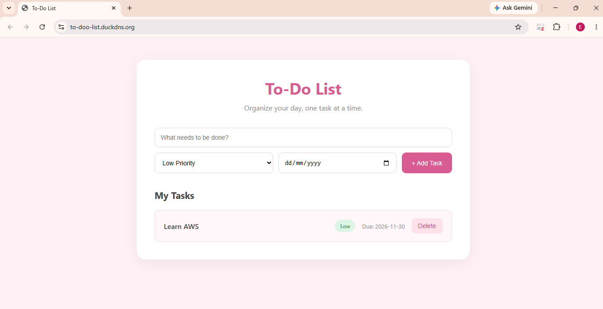

# To-Do List Application

A web-based task management application built with Python and Flask, deployed on AWS. The application allows users to organize daily tasks, set priorities, and manage deadlines.

## Features

- Create and manage tasks.
- Assign priority levels to tasks.
- Set due dates for tasks.
- Store and manage task data using a database.

## Technology Stack

- **Backend:** Python, Flask
- **Database:** SQLite
- **Web Server:** Nginx
- **Application Server:** Gunicorn
- **Cloud Platform:** AWS
- **Operating System:** Ubuntu Linux
- **Version Control:** Git and GitHub

## AWS Services

- Amazon EC2 – Application hosting
- Amazon S3 – Cloud storage
- Amazon RDS – Managed database
- Amazon CloudWatch – Monitoring
- AWS Systems Manager – Instance management

## Live Application

[View Live Application](https://to-doo-list.duckdns.org/)

## Screenshots

## Project Preview

